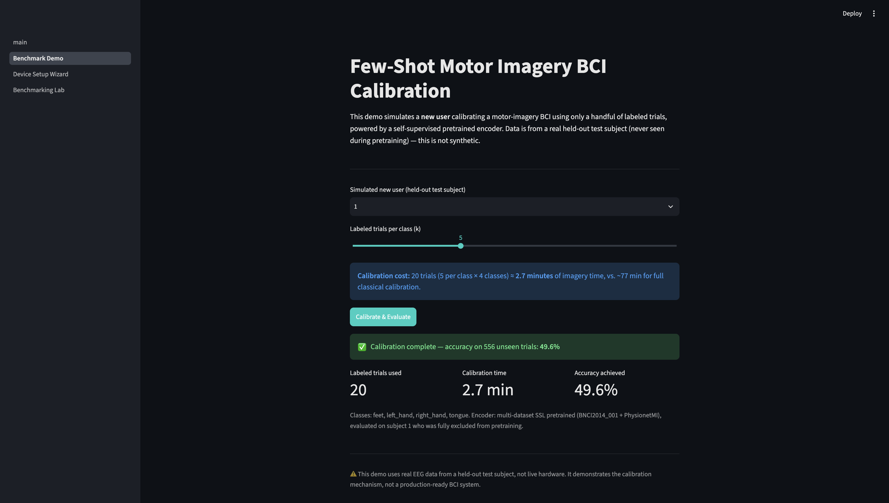
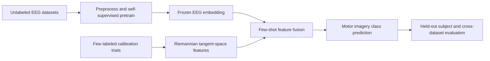

# Self-Supervised Pretraining for Cross-Subject Motor Imagery BCI

An EEG self-supervised encoder paired with a Riemannian feature fusion that aims to reduce labeled motor-imagery calibration time and transfer across datasets.

## Results

Numbers below are reported in the repository's benchmark documentation. The dependency installation did not complete during this review, so these results were not reproduced here.

| Evaluation | Result |
|---|---|
| BNCI2014_001, 20 labeled trials | 58.2% accuracy with pretrained + Riemannian fusion, versus 72.3% full-data baseline |
| Calibration budget | 80 labeled trials / about 10.7 min versus 576 trials / about 76.8 min for full calibration; reported 86% time reduction |
| Cross-dataset transfer, k=20 | BNCI→PhysioNetMI 52.8%; PhysioNetMI→BNCI 57.9% |



## Architecture



## Quickstart and verification

The documented setup requires installing requirements and the local package, then placing a pretrained checkpoint in `checkpoints/`. A from-scratch training command is documented, but the requirements installation did not complete during this review; no run is claimed as verified.

```bash
python3 -m venv .venv
source .venv/bin/activate
pip install -r requirements.txt
pip install -e .
mkdir -p checkpoints
python scripts/pretrain.py
```

For inference/evaluation, download the release checkpoint described in the repository README and follow its checkpoint layout before invoking the evaluation scripts.

## Limitations

- Results are from public datasets, not headset-in-the-loop testing.
- Few-shot performance still trails the full-data reference by 14.1 percentage points.
- Dataset transfer is encouraging but remains benchmark transfer, not evidence of general clinical or user-level robustness.
- A clean dependency install and end-to-end rerun remain unverified.

## Next steps

1. Add a lockfile and a small CPU smoke test for install, checkpoint loading, and inference.
2. Report subject-wise intervals and calibration curves alongside means.
3. Compare against a no-pretraining Riemannian baseline under identical splits.
4. Run a prospective calibration study with a real headset and held-out participants.
